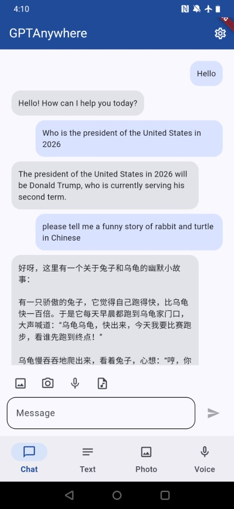
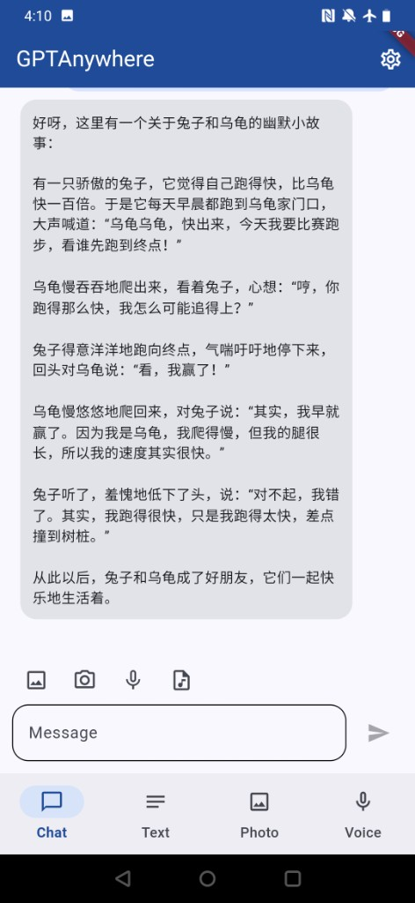
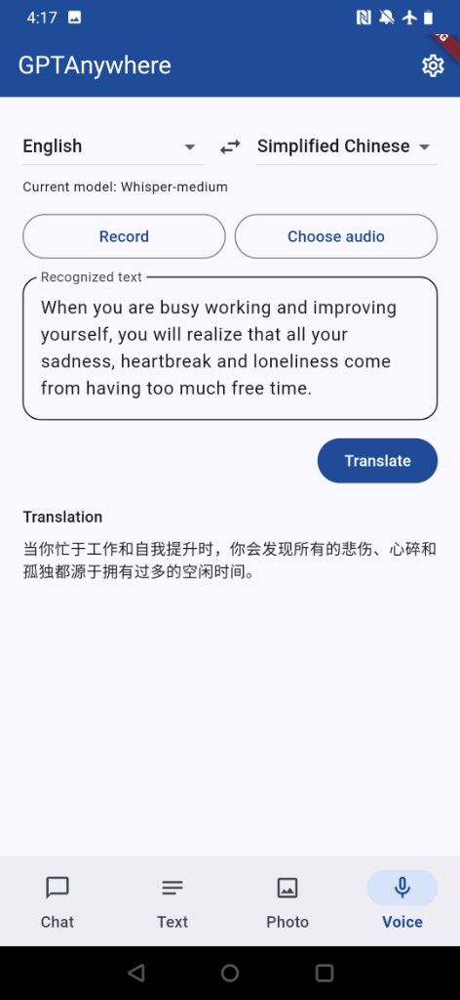
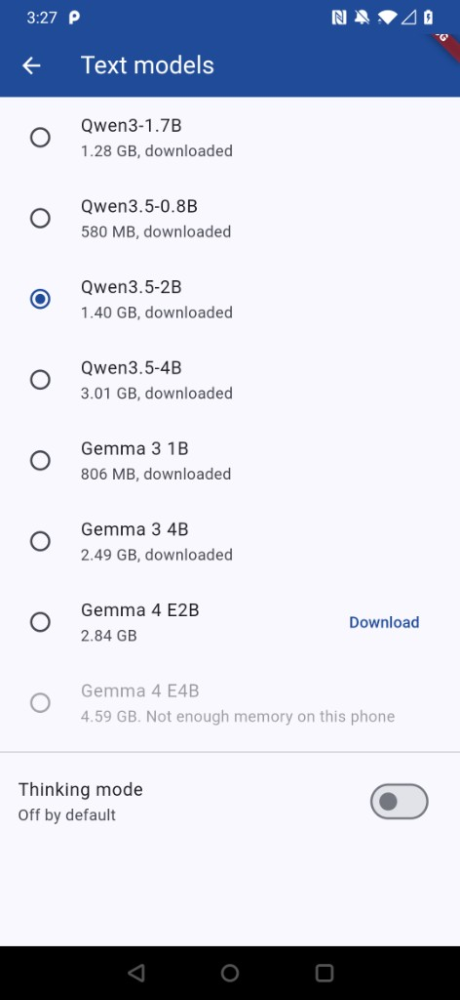
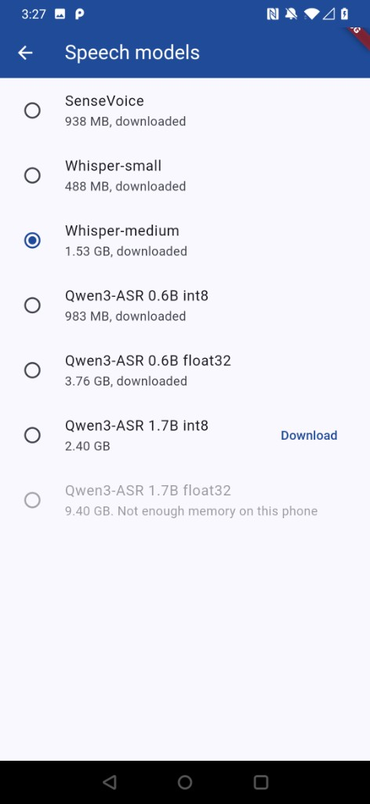

# GPTAnywhere

[中文](README.zh-CN.md)

## Overview

GPTAnywhere uses on-device large language models on a phone for conversation, and for translating text, photos, and speech. After a model is downloaded to the phone, it works offline. Use is not charged per request. The original text, pictures, recordings, and results are not uploaded. It does not need a network connection, and it is meant for free use and privacy.



## Features

- **Chat**: Talk freely with the current text model. The latest turns go into one call. Earlier turns that do not fit are dropped. The conversation stays only in memory for this process. Qwen3-1.7B and Gemma 3 1B recognize the text in a picture before sending it to the model. Other models first use that model's own mmproj to analyze the picture, then send it to the model.
- **Text**: Translate entered text with the current text model. The app detects the language and translates in either direction.
- **Photo**: Recognize the text in a photo, then translate it with the current text model. A camera photo is cropped first. Only the confirmed area is sent for recognition.
- **Voice**: Recognize text from a speech file or a recording, then translate it with the current text model. One recording lasts at most 30 seconds.
- **Settings**: Download text models and speech models.

## Models

**Text models**

| Model               | Size    | Vision file | Image | Context |
| ------------------- | ------- | ----------- | ----- | ------- |
| Qwen3-1.7B Q4_K_M   | 1.28 GB | None        | No    | 32K     |
| Qwen3.5-0.8B Q4_K_M | 580 MB  | 205 MB      | Yes   | 262K    |
| Qwen3.5-2B Q4_K_M   | 1.40 GB | 668 MB      | Yes   | 262K    |
| Qwen3.5-4B Q4_K_M   | 3.01 GB | 672 MB      | Yes   | 262K    |
| Gemma 3 1B Q4_K_M   | 806 MB  | None        | No    | 32K     |
| Gemma 3 4B Q4_K_M   | 2.49 GB | 851 MB      | Yes   | 128K    |
| Gemma 4 E2B Q4_0    | 2.84 GB | 557 MB      | Yes   | 128K    |
| Gemma 4 E4B Q4_0    | 4.59 GB | 560 MB      | Yes   | 128K    |

A vision file is the other file next to a language model. It is also called mmproj. It turns a picture into data that model can read. The size in the table is this file itself, downloaded in addition to the language model. Each model uses only its own vision file. A model marked None cannot read a picture directly. In Chat, the text in the picture is recognized first and then passed to the model.

**Speech models**

| Model                  | Size    | Languages                                        |
| ---------------------- | ------- | ------------------------------------------------ |
| SenseVoice             | 938 MB  | 5 (Chinese, English, Japanese, Korean, **Cantonese**) |
| Whisper-small          | 488 MB  | 99                                               |
| Whisper-medium         | 1.53 GB | 99                                               |
| Qwen3-ASR 0.6B int8    | 983 MB  | 30                                               |
| Qwen3-ASR 0.6B float32 | 3.76 GB | 30                                               |
| Qwen3-ASR 1.7B int8    | 2.40 GB | 30                                               |
| Qwen3-ASR 1.7B float32 | 9.40 GB | 30                                               |

**Image text recognition**  
Text in pictures is recognized with ML Kit Text Recognition. It supports more than 35 languages.

## Implementation

Languages: the interface and app logic use Flutter 3.41.6 (Dart 3.11.4) or newer. The Android bridge uses Kotlin. The iOS bridge uses Swift and Objective-C++. The text and speech inference libraries are C/C++.

Text models share one call path. Dart's `LlamaTranslationEngine` and `LlamaChatEngine` pass the model file to the native layer on the channel `dev.local.gptanywhere/llama`.

| Text model | Module | Android | iOS |
| --- | --- | --- | --- |
| Qwen3-1.7B | llama.cpp | `LlamaBridge.kt` starts the llama.cpp command-line program | `IosLlama.mm` calls llama.cpp inside the process |
| Qwen3.5-0.8B | llama.cpp | Same | Same |
| Qwen3.5-2B | llama.cpp | Same | Same |
| Qwen3.5-4B | llama.cpp | Same | Same |
| Gemma 3 1B | llama.cpp | Same | Same |
| Gemma 3 4B | llama.cpp | Same | Same |
| Gemma 4 E2B | llama.cpp | Same | Same |
| Gemma 4 E4B | llama.cpp | Same | Same |

Changing the model only changes its GGUF file.

Speech models use one of two native programs, chosen by the engine. Dart's `PlatformSpeechEngine` sends the engine name and model path on the channel `dev.local.gptanywhere/asr`.

| Speech model | Module | Android | iOS |
| --- | --- | --- | --- |
| SenseVoice | sherpa-onnx | `AsrBridge.kt` starts `libsherpa_offline.so` | `IosSherpa.mm` calls sherpa-onnx |
| Whisper-small | whisper.cpp | `AsrBridge.kt` starts `libwhisper_cli.so` | `IosWhisper.mm` calls whisper.cpp |
| Whisper-medium | whisper.cpp | Same | Same |
| Qwen3-ASR 0.6B int8 | sherpa-onnx | `AsrBridge.kt` starts `libsherpa_offline.so` | `IosSherpa.mm` calls sherpa-onnx |
| Qwen3-ASR 0.6B float32 | sherpa-onnx | Same | Same |
| Qwen3-ASR 1.7B int8 | sherpa-onnx | Same | Same |
| Qwen3-ASR 1.7B float32 | sherpa-onnx | Same | Same |

Image text recognition uses the ML Kit plugin. It does not enter the text or speech programs above.

## Build and install

Requires JDK 17 or 21, Flutter, the Android SDK and NDK, and Xcode.

```sh
git clone <repository-url>
cd translateanywhere
flutter pub get
```

Inference source lives in `third_party/`. Clone llama.cpp and whisper.cpp with the commands below. sherpa-onnx is cloned when it is built.

```sh
mkdir -p third_party
git clone https://github.com/ggml-org/llama.cpp third_party/llama.cpp
git -C third_party/llama.cpp checkout 29c720eaf72fcf8e4e61a56a88b994d92668261d
git clone https://github.com/ggml-org/whisper.cpp third_party/whisper.cpp
git -C third_party/whisper.cpp checkout 482279b8a18855ba741d7b88c30fcb3874691f59
```

Then build the inference programs.

```sh
# Android
sh native/llm/build_android.sh
sh native/asr/build_android.sh
sh native/asr/build_sherpa_android.sh

# iOS. Static libraries are written to native/prebuilt/ios/. That directory is not committed.
sh native/llm/build_ios.sh
sh native/asr/build_whisper_ios.sh
sh native/asr/build_sherpa_ios.sh
```

Download model weights in Settings after the app is installed on the phone.

Android debug:

```sh
adb devices -l
flutter build apk --debug --target-platform android-arm64
adb -s <device-id> install -r build/app/outputs/flutter-apk/app-debug.apk
adb -s <device-id> shell am force-stop dev.local.gptanywhere
adb -s <device-id> shell am start -n dev.local.gptanywhere/.MainActivity
```

iOS debug: the app must be signed before it can be built and installed. Open `ios/Runner.xcworkspace` in Xcode, and turn on Developer Mode on the iPhone. After installation, trust this developer app in Settings → General → VPN & Device Management. Otherwise the system blocks the app when it is opened.

```sh
flutter devices
flutter run -d <device-id> --debug
```

## Tests

Android  
Galaxy S21 (8 GB RAM, model SM-G991U, Android 13). When memory is under 12 GB, Gemma 4 E4B cannot be selected. When memory is under 16 GB, Qwen3-ASR 1.7B float32 cannot be selected.

Text models

- Available: Qwen3-1.7B (1.28 GB), Qwen3.5-0.8B (580 MB), Qwen3.5-2B (1.40 GB), Qwen3.5-4B (3.01 GB), Gemma 3 1B (806 MB), Gemma 3 4B (2.49 GB), Gemma 4 E2B (2.84 GB)
- Unavailable: Gemma 4 E4B (4.59 GB)

Speech models

- Available: SenseVoice (938 MB), Whisper-small (488 MB), Whisper-medium (1.53 GB), Qwen3-ASR 0.6B int8 (983 MB), Qwen3-ASR 0.6B float32 (3.76 GB), Qwen3-ASR 1.7B int8 (2.40 GB)
- Unavailable: Qwen3-ASR 1.7B float32 (9.40 GB)

Token speed  
Parameters: context 2048, temperature 0.2, 4 threads.

| Model | Prompt | Generation |
| --- | --- | --- |
| Qwen3-1.7B Q4_K_M | about 24 token/s | about 15 token/s |
| Qwen3.5-0.8B Q4_K_M | about 53 token/s | about 26 token/s |
| Qwen3.5-2B Q4_K_M | about 21 token/s | about 12 token/s |
| Qwen3.5-4B Q4_K_M | about 8 token/s | about 5 token/s |
| Gemma 3 1B Q4_K_M | about 37–40 token/s | about 23–24 token/s |
| Gemma 3 4B Q4_K_M | about 9–10 token/s | about 5–6 token/s |
| Gemma 4 E2B Q4_0 | about 13–15 token/s | about 9 token/s |

iOS  
iPhone 14 (6 GB RAM, iOS 26.6.2). Token speed with the same parameters.

| Model | Prompt | Generation |
| --- | --- | --- |
| Qwen3-1.7B Q4_K_M | about 103–252 token/s | about 26 token/s |
| Qwen3.5-0.8B Q4_K_M | about 43–273 token/s | about 39–44 token/s |
| Qwen3.5-2B Q4_K_M | about 54–144 token/s | about 20 token/s |
| Gemma 3 1B Q4_K_M | about 77–268 token/s | about 36 token/s |
| Gemma 3 4B Q4_K_M | about 49–69 token/s | about 12 token/s |
| Gemma 4 E2B Q4_0 | about 52–137 token/s | about 18–19 token/s |

Both phones are from before 2022. GPTAnywhere runs on most current phones.
