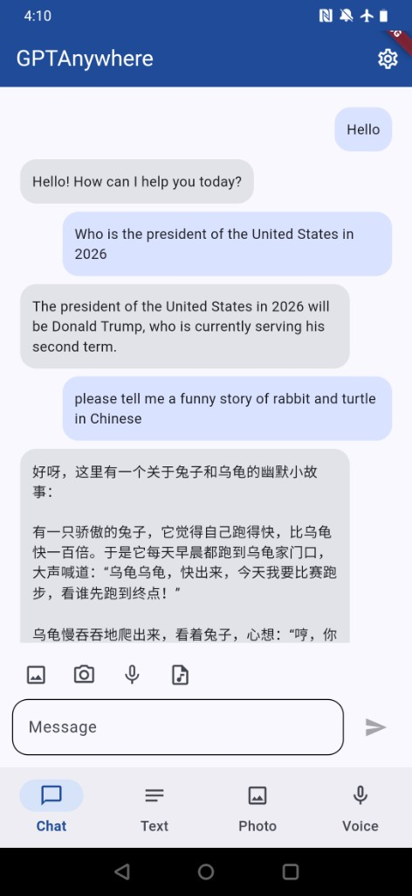
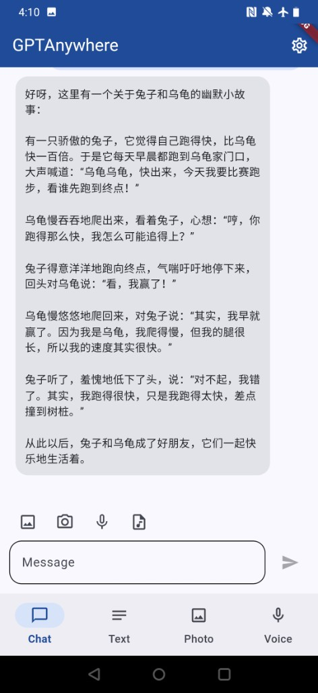
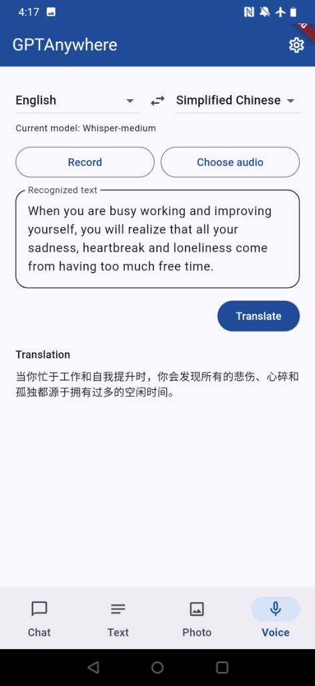
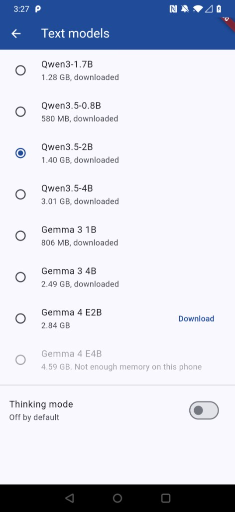
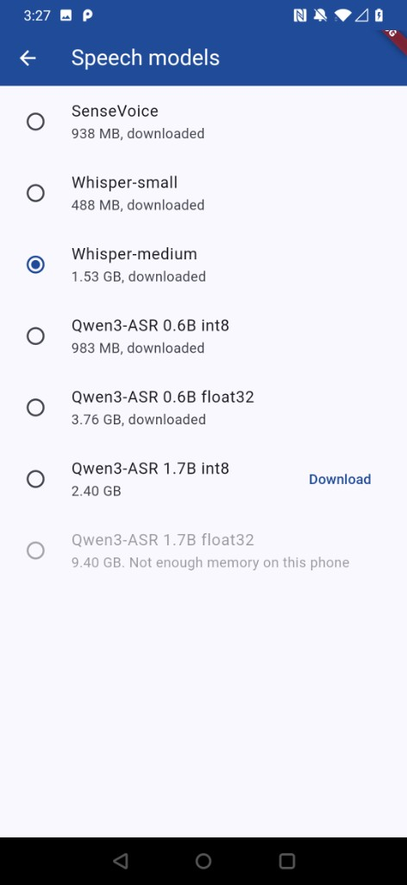

# GPTAnywhere

[English](README.md)

## 概要

GPTAnywhere 在手机上使用端侧大模型实现对话，并翻译文字、图片和语音。模型下载到本机后可以离线使用，不按token付费，对话原文、图片、录音和结果也不会上传。无需联网、兼顾免费使用与隐私安全。



## 功能

- **Chat**：与当前文字模型进行自由对话。最近几轮放进一次调用，放不下的更早轮次丢掉。对话目前只留在这次进程的内存里。Qwen3-1.7B 和 Gemma 3 1B 先识别图片文字再发给模型。其它模型先使用该模型自己的 mmproj 对图片进行分析，再提交给模型。
- **Text**：通过当前文字模型对输入文本进行翻译，自动识别文本语言进行相互翻译。
- **Photo**：识别出照片里的文字，再通过当前文字模型进行翻译。拍照后先裁剪，确认的区域才送去识别。
- **Voice**：识别出所语音文件或录音的的文字，再通过当前文字模型进行翻译。单次录音最长 30 秒。
- Settings：管理文本模型以及语音模型的下载。

## 模型

**文本模型**

| 模型名称                | 模型大小    | 看图文件大小 | 图片解析 | 上下文长度 |
| ------------------- | ------- | ------ | ---- | ----- |
| Qwen3-1.7B Q4_K_M   | 1.28 GB | 无      | 不支持  | 32K   |
| Qwen3.5-0.8B Q4_K_M | 580 MB  | 205 MB | 支持   | 262K  |
| Qwen3.5-2B Q4_K_M   | 1.40 GB | 668 MB | 支持   | 262K  |
| Qwen3.5-4B Q4_K_M   | 3.01 GB | 672 MB | 支持   | 262K  |
| Gemma 3 1B Q4_K_M   | 806 MB  | 无      | 不支持  | 32K   |
| Gemma 3 4B Q4_K_M   | 2.49 GB | 851 MB | 支持   | 128K  |
| Gemma 4 E2B Q4_0    | 2.84 GB | 557 MB | 支持   | 128K  |
| Gemma 4 E4B Q4_0    | 4.59 GB | 560 MB | 支持   | 128K  |

看图文件是语言模型旁边的另一个文件，也叫 mmproj。它把图片变成该模型能读的数据。表中的大小是这个文件本身，要在语言模型之外再下载。每个模型只用自己的看图文件。写着「无」的模型不能直接看图片，对话里会先把图片里的文字识别出来再交给模型。

**语音模型**

| 模型名称                   | 模型大小    | 语言数量                                             |
| ---------------------- | ------- | ------------------------------------------------ |
| SenseVoice             | 938 MB  | 5（Chinese、English、Japanese、Korean、**Cantonese**） |
| Whisper-small          | 488 MB  | 99                                               |
| Whisper-medium         | 1.53 GB | 99                                               |
| Qwen3-ASR 0.6B int8    | 983 MB  | 30                                               |
| Qwen3-ASR 0.6B float32 | 3.76 GB | 30                                               |
| Qwen3-ASR 1.7B int8    | 2.40 GB | 30                                               |
| Qwen3-ASR 1.7B float32 | 9.40 GB | 30                                               |

**图片识别**  
图片里的文字识别使用 ML Kit Text Recognition 识别。支持超过35种语言。

## 技术

开发语言：界面和业务用 Flutter 3.41.6（Dart 3.11.4）及以上。Android 桥接用 Kotlin。iOS 桥接用 Swift 和 Objective-C++。文字和语音的推理库是 C/C++。

文本模型都走同样的调用方式。Dart 的 `LlamaTranslationEngine` 和 `LlamaChatEngine` 经通道 `dev.local.gptanywhere/llama` 把模型文件交给原生层。

| 文本模型 | 调用模块 | Android | iOS |
| --- | --- | --- | --- |
| Qwen3-1.7B | llama.cpp | `LlamaBridge.kt` 启动 llama.cpp 命令行程序 | `IosLlama.mm` 在进程内调用 llama.cpp |
| Qwen3.5-0.8B | llama.cpp | 同上 | 同上 |
| Qwen3.5-2B | llama.cpp | 同上 | 同上 |
| Qwen3.5-4B | llama.cpp | 同上 | 同上 |
| Gemma 3 1B | llama.cpp | 同上 | 同上 |
| Gemma 3 4B | llama.cpp | 同上 | 同上 |
| Gemma 4 E2B | llama.cpp | 同上 | 同上 |
| Gemma 4 E4B | llama.cpp | 同上 | 同上 |

换模型只更换各自的 GGUF 文件。

语音模型按所选引擎分两条原生程序。Dart 的 `PlatformSpeechEngine` 经通道 `dev.local.gptanywhere/asr` 传出引擎名和模型路径。

| 语音模型 | 调用模块 | Android | iOS |
| --- | --- | --- | --- |
| SenseVoice | sherpa-onnx | `AsrBridge.kt` 启动 `libsherpa_offline.so` | `IosSherpa.mm` 调用 sherpa-onnx |
| Whisper-small | whisper.cpp | `AsrBridge.kt` 启动 `libwhisper_cli.so` | `IosWhisper.mm` 调用 whisper.cpp |
| Whisper-medium | whisper.cpp | 同上 | 同上 |
| Qwen3-ASR 0.6B int8 | sherpa-onnx | `AsrBridge.kt` 启动 `libsherpa_offline.so` | `IosSherpa.mm` 调用 sherpa-onnx |
| Qwen3-ASR 0.6B float32 | sherpa-onnx | 同上 | 同上 |
| Qwen3-ASR 1.7B int8 | sherpa-onnx | 同上 | 同上 |
| Qwen3-ASR 1.7B float32 | sherpa-onnx | 同上 | 同上 |

图片文字识别走 ML Kit 插件，不进入上面的文字程序或语音程序。

## 编译和安装

需要 JDK 17 或 21、Flutter、Android SDK 和NDK，以及XCode。

```sh
git clone <仓库地址>
cd translateanywhere
flutter pub get
```

推理源码在 `third_party/`。llama.cpp 和 whisper.cpp 要按下面的命令进行克隆。sherpa-onnx 会在编译时候进行克隆下载。

```sh
mkdir -p third_party
git clone https://github.com/ggml-org/llama.cpp third_party/llama.cpp
git -C third_party/llama.cpp checkout 29c720eaf72fcf8e4e61a56a88b994d92668261d
git clone https://github.com/ggml-org/whisper.cpp third_party/whisper.cpp
git -C third_party/whisper.cpp checkout 482279b8a18855ba741d7b88c30fcb3874691f59
```

然后编译推理程序。

```sh
# Android
sh native/llm/build_android.sh
sh native/asr/build_android.sh
sh native/asr/build_sherpa_android.sh

# iOS，静态库写到 native/prebuilt/ios/，该目录不提交
sh native/llm/build_ios.sh
sh native/asr/build_whisper_ios.sh
sh native/asr/build_sherpa_ios.sh
```

模型权重需要等应用装到手机之后，在设置里下载。

Android 调试：

```sh
adb devices -l
flutter build apk --debug --target-platform android-arm64
adb -s <设备号> install -r build/app/outputs/flutter-apk/app-debug.apk
adb -s <设备号> shell am force-stop dev.local.gptanywhere
adb -s <设备号> shell am start -n dev.local.gptanywhere/.MainActivity
```

iOS 调试：必须签名后才能编译安装（Xcode 打开 `ios/Runner.xcworkspace`），同时需要打开 iPhone 的开发者模式。安装后还要到「设置 → 通用 → VPN 与设备管理」里信任这个开发者 App，否则点开会被系统拦住。

```sh
flutter devices
flutter run -d <设备号> --debug
```

## 测试

Android  
Galaxy S21（8GB 内存，机型 SM-G991U，Android 13）。内存低于 12GB，Gemma 4 E4B 不可选。内存低于 16GB，Qwen3-ASR 1.7B float32 不可选。

文本模型

- 可选：Qwen3-1.7B（1.28 GB）、Qwen3.5-0.8B（580 MB）、Qwen3.5-2B（1.40 GB）、Qwen3.5-4B（3.01 GB）、Gemma 3 1B（806 MB）、Gemma 3 4B（2.49 GB）、Gemma 4 E2B（2.84 GB）
- 不可选：Gemma 4 E4B（4.59 GB）

语音模型

- 可选：SenseVoice（938 MB）、Whisper-small（488 MB）、Whisper-medium（1.53 GB）、Qwen3-ASR 0.6B int8（983 MB）、Qwen3-ASR 0.6B float32（3.76 GB）、Qwen3-ASR 1.7B int8（2.40 GB）
- 不可选：Qwen3-ASR 1.7B float32（9.40 GB）

Token 速度  
参数设置为上下文 2048、温度 0.2、4 线程。

| 模型 | 提示 | 生成 |
| --- | --- | --- |
| Qwen3-1.7B Q4_K_M | 约 24 token/s | 约 15 token/s |
| Qwen3.5-0.8B Q4_K_M | 约 53 token/s | 约 26 token/s |
| Qwen3.5-2B Q4_K_M | 约 21 token/s | 约 12 token/s |
| Qwen3.5-4B Q4_K_M | 约 8 token/s | 约 5 token/s |
| Gemma 3 1B Q4_K_M | 约 37–40 token/s | 约 23–24 token/s |
| Gemma 3 4B Q4_K_M | 约 9–10 token/s | 约 5–6 token/s |
| Gemma 4 E2B Q4_0 | 约 13–15 token/s | 约 9 token/s |

iOS  
iPhone 14（6GB 内存，iOS 26.6.2），同样参数设置下的 Token 速度。

| 模型 | 提示 | 生成 |
| --- | --- | --- |
| Qwen3-1.7B Q4_K_M | 约 103–252 token/s | 约 26 token/s |
| Qwen3.5-0.8B Q4_K_M | 约 43–273 token/s | 约 39–44 token/s |
| Qwen3.5-2B Q4_K_M | 约 54–144 token/s | 约 20 token/s |
| Gemma 3 1B Q4_K_M | 约 77–268 token/s | 约 36 token/s |
| Gemma 3 4B Q4_K_M | 约 49–69 token/s | 约 12 token/s |
| Gemma 4 E2B Q4_0 | 约 52–137 token/s | 约 18–19 token/s |  

以上是两款都是2022年之前的移动设备，当前绝大部分手机可以顺利运行 GPTAnywhere。
